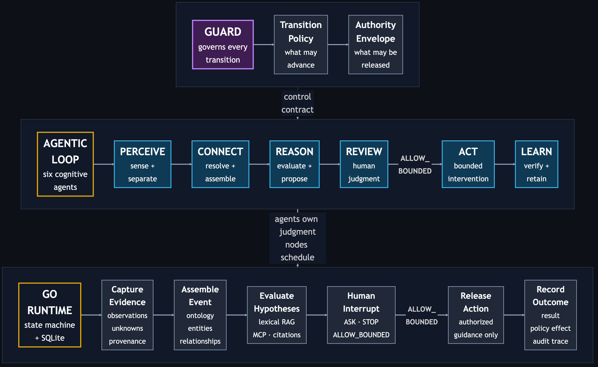
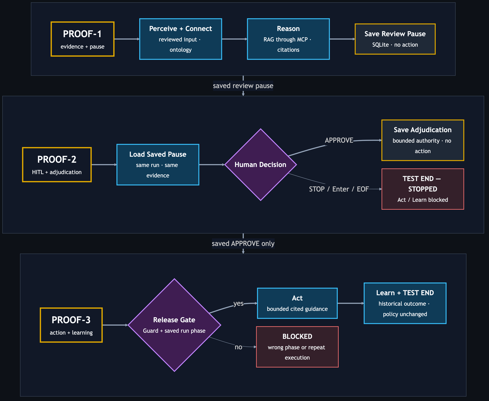

# Agentic Salmon — Go

- **Owner:** Joseph Shi — [aixstudio](https://github.com/aixstudio)
- **Role:** Principal Architect — Agentic AI & Data Platform
- **Created:** 2026-10-17 · **Updated:** 2026-10-18

Agentic Salmon demonstrates how an agentic system moves from uncertain evidence to human-approved guidance. Its architecture separates agent responsibilities, Guard authority, and workflow execution.

## Architecture at a Glance

Read the three bands from top to bottom: Guard defines authority, the six
agents own judgments, and the Go runtime schedules and persists execution.



[Diagram source](docs/diagrams/architecture.mmd)

The execution band is native Go, with SQLite checkpoints across CLI invocations.
It runs no Python or LangGraph. The two saved boundaries are the Proof-1 human
review pause and the Proof-2 adjudication before action; Proof-3 releases
Act/Learn through the same Guard contract.

### What “orthogonal” means here

Orthogonal means a separate concern that applies across other components.
The six agents perform the work: Perceive → Connect → Reason → Review → Act →
Learn. Guard governs which transitions and actions may proceed throughout that
sequence. It is not a seventh stage.

The responsibilities are separate and interact through constraints: **agents
perform work; Guard constrains what may proceed**. The runtime schedules and
checkpoints that work. Python uses LangGraph; Go uses its native state machine.

## About This Implementation

I validate architecture through runnable code, explicit contracts, and behavioral
proofs. This implementation uses Go; the sibling implementation uses Python.

A native Go port of [Agentic Salmon Python](https://github.com/aixstudio/agentic-salmon-python),
showing how evidence, ontology, retrieval, and human authority constrain agent action.

```text
GUARD ⊣ [PERCEIVE → CONNECT → REASON → REVIEW → ACT → LEARN]
```

All six agents execute typed contracts. Reason queries a small reviewed corpus
through the **official MCP Go SDK over stdio**. Review pauses the workflow;
Act requires a supported or plausible working hypothesis, explicit acceptance
of uncertainty, and authorization for bounded cited guidance. Learn preserves
outcome and preference evidence without weakening policy.


*Reviewed meal-prep input; food identity and safety remain unverified.*

## Logic Flow — One Run, Three Proofs

One case moves from evidence to human approval to a controlled response. Approval gives permission to proceed; it does not resolve missing facts. Keep the same run ID throughout, even if you close the terminal between steps. Full details are in `log/<run-id>.log`.



[Diagram source](docs/diagrams/logic-flow.mmd)

1. **Proof-1 — Show the evidence and pause.**

   **Known:** The evidence suggests fish, and supporting reference guidance is available.

   **Not known:** Food identity, ingredients and allergens, storage history, odor, and freshness and safety remain unverified. No response has been authorized.

   **Next:** Review the evidence, missing facts, and proposed limits. Continue to Proof-2 to approve or stop the saved case.

2. **Proof-2 — Let a person decide.**

   **Known:** Choosing `APPROVE` records permission to provide limited guidance backed by sources. Guidance has not yet been released.

   **Not known:** The same food facts remain unverified. Approval accepts those limits; it does not establish safety.

   **Next:** Continue to Proof-3 only after approval is saved. `STOP` or Enter ends the case without releasing guidance.

3. **Proof-3 — Deliver the approved guidance and close.**

   **Known:** The approved guidance is released, and a historical outcome and preference are recorded. Safety rules stay unchanged.

   **Not known:** The original missing facts remain unresolved. No new cooking or safety test has occurred.

   **Finish:** Expect `TEST END — PASS`. The demo is complete; inspect the log for detail. The completed case cannot release guidance again.


## Technology Stack and Rationale

| Technology | Role in this demo | Why it was chosen |
| --- | --- | --- |
| Go 1.25+ | Typed agent contracts and compiled CLI/server runtime | Keeps ownership and failure paths visible in one executable, without a Python runtime dependency. |
| Native Go state machine | Stage scheduling, adjudication and action release | Makes the transition logic explicit while keeping it separate from agent judgment. |
| Pure-Go SQLite | Durable proof checkpoints and conditional phase claims | Allows normal process exits between proofs and blocks wrong-order, concurrent or repeated execution without a hosted database. |
| Official MCP Go SDK over stdio | Separate client/server `search_knowledge` call | Proves the knowledge capability can be replaced behind a real protocol boundary. |
| TF-IDF vectors and cosine ranking | Query-dependent retrieval over the reviewed corpus | Keeps the Go proof self-contained; this is lexical retrieval, with no claim of dense semantic equivalence. |
| Embedded reviewed JSON corpus and SHA-256 content digests | Ranked chunks, citations and source text identity | Makes the exact evidence used by Reason and Act inspectable. Digests do not authenticate a malicious source. |
| JSON run logs and `go test -race` | Detailed evidence and behavioral validation | Exposes run state, timings, MCP metadata, authority and replay protection without flooding the terminal. |

## Why Python and Go

Python keeps LangGraph orchestration and FastEmbed dense semantic retrieval
close to their supported libraries. Go makes the same authority contracts
inspectable in a compiled runtime, with native orchestration and self-contained
lexical retrieval. Neither choice establishes a performance advantage here.
The architectural proof is that evidence, human authority and bounded action
retain their contracts when implementation choices change.

## Build and test

Install Go 1.25 or later ([official downloads](https://go.dev/dl/); on macOS,
`brew install go`). Then run from the repository root:

```bash
go mod download
go test -race ./...
go vet ./...
go build -o bin/agentic-salmon ./cmd/agentic-salmon
```

The executable contains the reviewed knowledge corpus. There is no Python,
model download, API key, external service, or vector database dependency.
The CLI loads the reviewed image and observation fixture from the checkout.

## Run the Three Incremental HITL Proofs

Use the same run ID in all three commands. These proofs continue **one durable
run**, including after closing and reopening the terminal. For a repeat test,
use a new run ID in all three commands; existing runs are never overwritten.

### Proof-1 — Intentional pause for HITL

**Proof ID:** Proof-1

**Test Conditions:** Run from the repository root with a fresh `salmon-demo-001`
run ID. The reviewed image, fixture, and corpus are available. No approval has
been supplied. This step performs real retrieval across the MCP boundary.

**Test Cmd:**

```bash
./bin/agentic-salmon proof-1 --run-id salmon-demo-001
```

**What to Expect:** Perceive → Connect → Reason execute, then the system pauses
before Review. The terminal tells you what to review: evidence supports `fish`
as a working hypothesis, species remains unverified, all five unknowns must be
retained, and only cited bounded guidance may be authorized. Act/Learn do not
run. The checkpoint is saved in `log/salmon-demo-001.sqlite3`; detailed evidence,
retrieval results, citations, MCP metadata, timings, and state are recorded in
`log/salmon-demo-001.log`.

**What to Do Next:** Review the evidence boundary and requested authority.
Continue to Proof-2 with this same run ID. You may exit the terminal first.

### Proof-2 — Human review and adjudication of the saved run

**Proof ID:** Proof-2

**Test Conditions:** Proof-1 is paused for `salmon-demo-001`. No stage is rerun.
The system displays the saved review contract. The deterministic acceptance
path uses the single prescribed answer `APPROVE`; no storage, odor, or other
free-text observations are requested.

**Test Cmd:**

```bash
./bin/agentic-salmon proof-2 --run-id salmon-demo-001
```

At the system prompt, type exactly:

```text
APPROVE
```

**What to Expect:** Review records `ALLOW_BOUNDED`: select the evidence-supported
`fish` hypothesis, acknowledge **all** retained unknowns, and authorize only
bounded cited guidance. The adjudication is saved under the same run ID.
Act/Learn still do not run. Watch out: approval is authority to release the
bounded response; it does not verify food identity or safety. `STOP`, Enter,
or end of input ends this run without action. Other input leaves it paused.

**What to Do Next:** For the prescribed `APPROVE` path, continue to Proof-3 with
the same run ID. A stopped run is a test end and cannot proceed to Proof-3.

### Proof-3 — Authorized action, learning, and test end

**Proof ID:** Proof-3

**Test Conditions:** Proof-2 saved an approved adjudication for
`salmon-demo-001`. Proof-3 consumes that decision; it cannot bypass Review.
The learning input is the fixed historical case outcome and preference from
the public story, explicitly labeled as historical evidence.

**Test Cmd:**

```bash
./bin/agentic-salmon proof-3 --run-id salmon-demo-001
```

**What to Expect:** Act releases only the human-authorized guidance supported
by a retrieved citation. Learn records the historical outcome and preference
with no policy change. The run contains all six stages exactly once, reports
`COMPLETED`, and acknowledges `TEST END — PASS`. Watch out: this executes a
bounded guidance artifact, not a cooking action or a new food-safety trial.
Full guidance, adjudication, citations, and learning evidence remain in the
same `log/salmon-demo-001.log`.

**What to Do Next:** The test is finished. Inspect the run log if deeper review
is needed. Repeating Proof-3 is rejected rather than replaying Act.

SQLite checkpoints and logs are local, ignored runtime artifacts. Keep them
if you want to resume or inspect a run. An operation interrupted during active
execution is blocked from automatic retry; this demo does not claim crash
recovery for arbitrary external side effects or production approval identity.

## Architecture and port choices

| Concern | Python sibling | Go implementation |
| --- | --- | --- |
| Agent contracts | Typed dataclasses | Typed structs and owned agent methods |
| Orchestration | LangGraph StateGraph and interrupt | Native state machine with SQLite-backed cross-process pickup |
| Knowledge protocol | Official MCP Python SDK, stdio | Official MCP Go SDK, stdio subprocess |
| Retrieval | FastEmbed dense semantic embeddings | Local TF-IDF sparse vectors and cosine ranking |
| Evidence and authority | Reviewed fixture, ontology, Guard | Same fixture, ontology rules, decisions and authority requirements |
| Audit | JSON run logs, SQLite checkpoints, node/MCP timing | JSON run logs, SQLite checkpoints, node/MCP timing |

The retrieval algorithm is an explicit difference: **Go does ranked lexical
RAG, not dense semantic retrieval**. Scores and top chunks can differ from
Python. The query is built from perceived evidence, connected entities,
unknowns, and candidates. Returned chunks augment Reason; Act requires a
matching retrieved citation. A query without vocabulary overlap returns no
chunks, and Reason fails closed. Replace `KnowledgePort` or the MCP server's
retriever to add a different retrieval backend.

LangGraph is a Python dependency, so the Go orchestration layer is a native
state machine. It retains the separation between agent judgment and node
scheduling. SQLite saves checkpoints between CLI invocations. Completion and refusal
prevent replaying Act. An active claim interrupted by a crash is not
automatically replayed.
This is a narrow architectural demo, with deterministic agent behavior and a
reviewed perception fixture; it does not claim live vision, autonomous LLM
reasoning, or production approval services.

Guard is separate from the six agents. It requires predecessor artifacts and
an allowed Review decision before Act. The runner configures one read-only
knowledge executable; Reason can only call `search_knowledge` through its
knowledge interface. Evidence cannot supply shell commands or tool names.
The server additionally exposes read-only `get_source` for source resolution.

See [port decisions](docs/adr/0001-controlled-workflow.md),
[ontology](docs/ontology.md), [threat model](docs/threat-model.md),
[validation record](docs/validation.md), [story](docs/story.md),
[image provenance](docs/image-provenance.md), and
[AI assistance](docs/ai-assistance.md).

## Evidence boundary

Visible portions, seasoning, skin-like surface, and equipment are observations.
Species, ingredients, allergens, freshness, and cold-chain history remain
unverified. Human recollection does not establish verified identity or safety.
Historical cooking outcomes remain historical evidence.

This is an architecture demonstration, not a food-safety system. Guidance is
bounded to the reviewed corpus and human authority. Consult the cited sources
and qualified guidance for real decisions.
