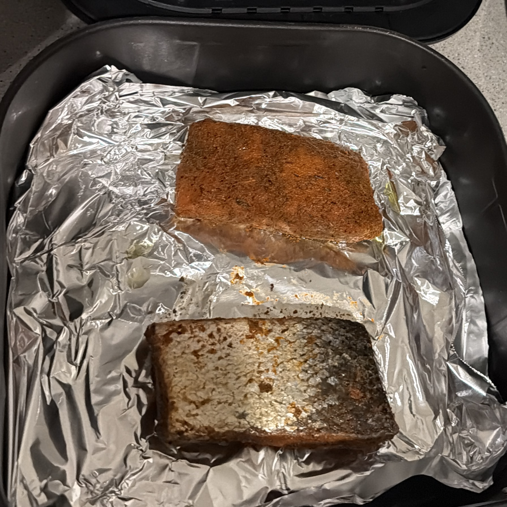

# Agentic Salmon — Go

A native Go port of [Agentic Salmon Python](https://github.com/aixstudio/agentic-salmon-deploy),
showing how evidence, ontology, retrieval, and human authority constrain agent action.

```text
GUARD ⊣ [PERCEIVE → CONNECT → REASON → REVIEW → ACT → LEARN]
```

All six agents execute typed contracts. Reason queries a small reviewed corpus
through the **official MCP Go SDK over stdio**. Review pauses the workflow;
Act requires a supported or plausible working hypothesis, explicit acceptance
of uncertainty, and authorization for bounded cited guidance. Learn preserves
outcome and preference evidence without weakening policy.



## Build and test

Install Go 1.25 or later ([official downloads](https://go.dev/dl/); on macOS,
`brew install go`). Then run from the repository root:

```bash
go mod download
go test -race ./...
go vet ./...
go build -o bin/agentic-salmon ./cmd/agentic-salmon
```

The executable contains the reviewed knowledge corpus. There is no Python,
model download, API key, external service, or vector database dependency.
The CLI loads the reviewed image and observation fixture from the checkout.

## Three progressive proofs

### 1. Deny by default

```bash
./bin/agentic-salmon demo
```

Expected: `status: interrupted`, `decision: ask`, `guidance: null`; only
Perceive, Connect, and Reason have executed. Reason's artifact contains ranked
chunks, citations, content digests, and negotiated MCP protocol metadata.

### 2. Interactive human review

```bash
./bin/agentic-salmon demo --interactive \
  --outcome "390°F for 14 minutes; wonderful and fresh-tasting" \
  --feedback "moderately spicy result preferred"
```

Select `2` or `fish`, answer `y` to accepting retained unknowns and authorizing
bounded guidance, then optionally provide storage and odor recollections.
Invalid or unknown hypotheses return to Review. `stop`, `n`, Enter at an
authorization prompt, or end of input stops without releasing guidance.
Prompts go to stderr; stdout remains machine-readable JSON.

Expected: all six stages complete on the same run ID after valid authorization.

### 3. Explicit automated authorization

```bash
./bin/agentic-salmon demo \
  --review allow-bounded \
  --selected-hypothesis fish \
  --storage-recollection "retrieved frozen from home freezer; exact cold chain unknown" \
  --odor-observation "seasoning smelled reminiscent of lasagna" \
  --outcome "390°F for 14 minutes; wonderful and fresh-tasting" \
  --feedback "moderately spicy result preferred"
```

`--review allow-bounded` explicitly supplies acceptance and authorization; it
still cannot authorize an unknown or unoffered hypothesis. `--review stop`
demonstrates refusal. The same workflow API supports `Start` and `Resume` with
typed `HumanEvidence` and separate optional boolean authority fields.

Reports are written under ignored `traces/`; use `--report-directory` to change
the location. Reports include timings and agent artifacts. No generative model
is called, so token usage is reported as unavailable.

## Architecture and port choices

| Concern | Python sibling | Go implementation |
| --- | --- | --- |
| Agent contracts | Typed dataclasses | Typed structs and owned agent methods |
| Orchestration | LangGraph StateGraph and interrupt | Native state machine with in-memory same-run pause/resume |
| Knowledge protocol | Official MCP Python SDK, stdio | Official MCP Go SDK, stdio subprocess |
| Retrieval | FastEmbed dense semantic embeddings | Local TF-IDF sparse vectors and cosine ranking |
| Evidence and authority | Reviewed fixture, ontology, Guard | Same fixture, ontology rules, decisions and authority requirements |
| Audit | JSON and Markdown, node timing | JSON and Markdown, node timing |

The retrieval algorithm is an explicit difference: **Go does ranked lexical
RAG, not dense semantic retrieval**. Scores and top chunks can differ from
Python. The query is built from perceived evidence, connected entities,
unknowns, and candidates. Returned chunks augment Reason; Act requires a
matching retrieved citation. A query without vocabulary overlap returns no
chunks, and Reason fails closed. Replace `KnowledgePort` or the MCP server's
retriever to add a different retrieval backend.

LangGraph is a Python dependency, so the Go orchestration layer is a native
state machine. It retains the separation between agent judgment and node
scheduling. Checkpoints last only for the current process; there is no durable
resume across CLI invocations. Completion and refusal prevent replaying Act.
This is a narrow architectural demo, with deterministic agent behavior and a
reviewed perception fixture; it does not claim live vision, autonomous LLM
reasoning, or production approval services.

Guard is separate from the six agents. It requires predecessor artifacts and
an allowed Review decision before Act. The runner configures one read-only
knowledge executable; Reason can only call `search_knowledge` through its
knowledge interface. Evidence cannot supply shell commands or tool names.
The server additionally exposes read-only `get_source` for source resolution.

See [port decisions](docs/adr/0001-controlled-workflow.md),
[ontology](docs/ontology.md), [threat model](docs/threat-model.md),
[validation record](docs/validation.md), [story](docs/story.md),
[image provenance](docs/image-provenance.md), and
[AI assistance](docs/ai-assistance.md).

## Evidence boundary

Visible portions, seasoning, skin-like surface, and equipment are observations.
Species, ingredients, allergens, freshness, and cold-chain history remain
unverified. Human recollection does not establish verified identity or safety.
Historical cooking outcomes remain historical evidence.

This is an architecture demonstration, not a food-safety system. Guidance is
bounded to the reviewed corpus and human authority. Consult the cited sources
and qualified guidance for real decisions.
